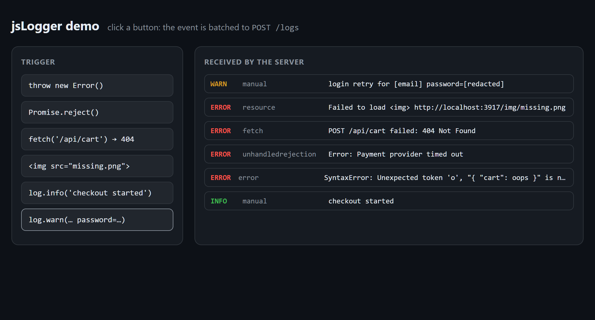
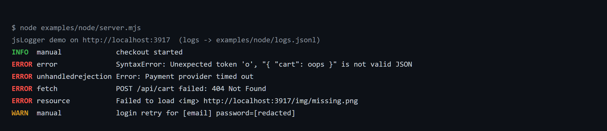
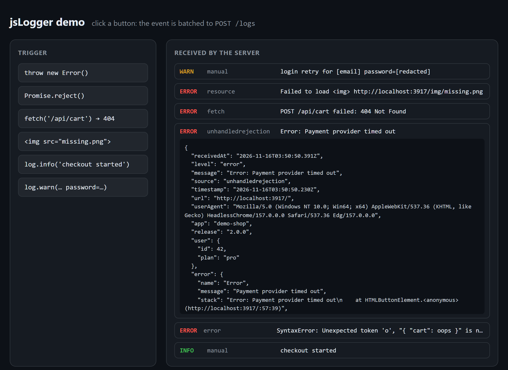

# jsLogger

[](https://github.com/lucaslobasso/js-logger/actions/workflows/ci.yml)
[](https://www.npmjs.com/package/@lucaslobasso/js-logger)
[](#how-it-works)
[](package.json)
[](LICENSE)

<p align="center">
  
</p>

Self-hosted error logging for the browser in one small script. jsLogger catches **uncaught errors, rejected promises, failed `fetch`/XHR calls and broken resources**, and posts them in batches as plain JSON to **an endpoint you own**. You don't need an account or a SaaS dashboard, and your users' data stays on your servers. It works with any backend and has adapters for **React, Vue and Angular**.

**[Why](#why) · [Install](#install) · [Quick start](#quick-start) · [Options](#options) · [Frameworks](#frameworks) · [Receiving logs](#receiving-logs) · [Payload](#payload) · [How it looks](#how-it-looks) · [How it works](#how-it-works) · [Troubleshooting](#troubleshooting)**

## Why

Hosted error trackers (Sentry, Bugsnag, LogRocket...) are great, but they bring an account, a bill, a large SDK and a third party that receives your users' data. Often all you want is to **see browser errors in the logs you already have**: a file, Serilog/NLog, Seq, ELK, CloudWatch. jsLogger does exactly that:

- **2.5 KB** min+brotli, zero dependencies, nothing to configure beyond a URL.
- Sends to **your** endpoint, in a [documented JSON format](#payload). A receiver is about 20 lines ([Node](examples/node/server.mjs), [ASP.NET Core](examples/aspnet-core/Program.cs)).
- Doesn't spam you: batched, deduplicated, sampled if you want, retried with backoff, and flushed when the page closes.
- **Privacy by default:** emails and values of keys like `password`, `token` or `authorization` are masked before anything leaves the browser.

It does not do session replay, source-map un-minifying or alerting. If you need those, use a hosted tracker.

## Install

```sh
npm install @lucaslobasso/js-logger
```

Or with no build step, from a CDN:

```html
<script src="https://cdn.jsdelivr.net/npm/@lucaslobasso/js-logger@2/dist/jsLogger.global.js"></script>
<script>
  jsLogger.init({ endpoint: '/logs' });
</script>
```

## Quick start

```js
import { init } from '@lucaslobasso/js-logger';

const log = init({
  endpoint: '/logs',            // or https://logs.example.com/ingest
  app: 'shop',
  release: '1.4.2',
});

// Everything below is optional: errors, rejections and failed requests are captured already.
log.setUser({ id: 42 });
log.info('checkout started', { items: 3 });

try {
  pay();
} catch (err) {
  log.exception(err, { orderId: 1001 });
}
```

Call `init` once, as early as possible. Anywhere else, `getLogger()` returns the same logger.

**Try it locally:** `npm install && npm run demo`, then open http://localhost:3000.

## Options

| Option | Default | What it does |
| --- | --- | --- |
| `endpoint` | *(required)* | URL that receives `POST { "events": [...] }`. Relative URLs resolve against the page |
| `level` | `'info'` | Lowest level sent: `trace` `debug` `info` `warn` `error` `fatal` |
| `app`, `release` | – | Added to every event |
| `context` | – | Extra fields on every event (merged with `setContext`) |
| `headers` | – | Extra request headers, e.g. `{ 'x-api-key': '…' }` |
| `credentials` | `'same-origin'` | `fetch` credentials mode for the log requests |
| `batchSize` | `10` | Events per request; a full batch is sent at once |
| `flushInterval` | `2000` | ms to wait for more events before sending a partial batch |
| `maxQueue` | `100` | Events kept while the endpoint is unreachable (oldest dropped) |
| `retries` | `3` | Retries on network errors, 5xx and 429 (1 s, 2 s, 4 s) |
| `dedupeMs` | `5000` | The same event (same fingerprint) is sent once per window. `0` = off |
| `sampleRate` | `1` | Share of events kept, `0` to `1` |
| `redact` | `true` | Mask emails, and values of keys like password / token / authorization / cookie / session / api key |
| `beforeSend` | – | `(event) => event \| null`: change an event, or return a falsy value to drop it |
| `captureErrors` | `true` | Uncaught exceptions and failed `<script>`/``/`<link>` loads |
| `captureRejections` | `true` | Unhandled promise rejections |
| `captureFetch` | `true` | `fetch` calls that fail or answer 4xx/5xx (aborts are ignored) |
| `captureXhr` | `true` | `XMLHttpRequest` calls, so jQuery and axios too |
| `captureConsole` | `false` | `console.error` and `console.warn` |

**Logger methods:** `trace/debug/info/warn/error/fatal(message, context?)`, `log(level, message, context?)`, `exception(error, context?)`, `setUser(user | null)`, `setContext(fields)`, `flush()`, `teardown()` (removes every hook and restores `fetch`, XHR and `console`).

## Frameworks

Call `init()` first; the adapters use that logger (or one you pass in).

**React:** wrap your app (or any subtree) in the error boundary:

```jsx
import { ErrorBoundary } from '@lucaslobasso/js-logger/react';

<ErrorBoundary fallback={(error, reset) => <button onClick={reset}>Something broke. Retry</button>}>
  <App />
</ErrorBoundary>
```

Render errors are logged with the component stack. `useLogger()` returns the logger.

**Vue 3:**

```js
import { jsLoggerPlugin } from '@lucaslobasso/js-logger/vue';

createApp(App).use(jsLoggerPlugin).mount('#app');
```

This logs errors from components, watchers and hooks, and keeps any `errorHandler` you already had.

**Angular:**

```ts
import { provideJsLogger } from '@lucaslobasso/js-logger/angular';

bootstrapApplication(AppComponent, { providers: [provideJsLogger()] });
```

This replaces Angular's `ErrorHandler` with one that logs, then prints the error as usual.

Svelte, Solid, plain JS and anything else are covered by the automatic capture: errors that escape your code reach `window`.

## Receiving logs

Your endpoint gets `POST` requests whose body is `{ "events": [ ...LogEvent ] }`, usually with `content-type: application/json`. **When the page is closing**, the last batch goes out with `navigator.sendBeacon` as **`text/plain`**, so parse the body as JSON whatever the content type says. Answer with any 2xx.

**Node** ([full example](examples/node/server.mjs), zero dependencies). It prints each event and appends it to a `.jsonl` file:



**ASP.NET Core** ([full example](examples/aspnet-core/Program.cs)). It writes each event through `ILogger`, so it lands in your existing Serilog/NLog/console sinks:

```csharp
app.MapPost("/logs", async (HttpRequest request, ILogger<Program> log) =>
{
    var batch = await JsonSerializer.DeserializeAsync<LogBatch>(request.Body, json);
    foreach (var e in batch!.Events)
        log.LogError("[browser] {Source} {Message} at {Url}{NewLine}{Stack}",
            e.Source, e.Message, e.Url, Environment.NewLine, e.Error?.Stack);
    return Results.NoContent();
});
```

Anything that accepts JSON over HTTP works too: a serverless function, a Cloudflare Worker, or a Logstash/Vector HTTP input.

## Payload

```jsonc
{
  "events": [
    {
      "level": "error",                     // trace | debug | info | warn | error | fatal
      "message": "Error: Payment provider timed out",
      "source": "unhandledrejection",       // manual | error | resource | unhandledrejection | fetch | xhr | console
      "timestamp": "2026-11-16T03:50:50.230Z",
      "url": "https://shop.example.com/checkout",
      "userAgent": "Mozilla/5.0 …",
      "app": "shop",
      "release": "1.4.2",
      "user": { "id": 42 },
      "context": { "orderId": 1001 },       // setContext + per-call context
      "error": {                            // when an Error was logged
        "name": "Error",
        "message": "Payment provider timed out",
        "stack": "Error: Payment provider timed out\n    at pay (checkout.js:57:39)",
        "cause": { "name": "Error", "message": "ETIMEDOUT" }
      },
      "fingerprint": "1x9k2bq"              // level + message + top frame: group or count by it
    }
  ]
}
```

TypeScript types: `import type { LogEvent } from '@lucaslobasso/js-logger'`.

## How it looks

**The demo** (top of this page): each button triggers one kind of problem, and the right panel shows what the server received. Opening an event shows the full JSON:



<sub>Captured from the real demo (`examples/browser` served by `examples/node`) in headless Edge: `npm run screenshots`.</sub>

## How it works

- **Capture:** a capture-phase `error` listener on `window` (which also sees failed resource loads, since those don't bubble), an `unhandledrejection` listener, and thin wrappers around `fetch`, `XMLHttpRequest.prototype.open/send` and, if enabled, `console.error/warn`. The logger's own requests are never captured, and `teardown()` puts every original back.
- **Shape:** each event gets the page URL, user agent, app/release, user and context. Errors are serialized by hand (name, message, stack, up to 3 levels of `cause`), because `JSON.stringify(new Error())` is `{}`.
- **Filter:** level → sampling → dedupe by fingerprint → redaction → `beforeSend`.
- **Deliver:** events queue in memory and go out as one `POST` per batch (when it fills, or after `flushInterval`), through the original `fetch`. 5xx, 429 and network errors are retried with backoff. Other 4xx answers are dropped with a single console warning. On `pagehide` or when the tab is hidden, whatever is queued goes out with `sendBeacon` (or `fetch(keepalive)` when you set custom headers), so errors from the last second before navigating away still arrive.

## Troubleshooting

- **Nothing arrives (CORS).** If the endpoint is on another origin, it must answer the preflight: `Access-Control-Allow-Origin: <your site>`, `Access-Control-Allow-Methods: POST`, `Access-Control-Allow-Headers: content-type` (plus any `headers` you added).
- **Blocked by Content-Security-Policy.** Add the endpoint's origin to `connect-src`.
- **The last events before leaving the page are missing on the server.** They were sent as `text/plain`; make sure the receiver parses the body as JSON regardless of the content type (ASP.NET `[FromBody]` and `express.json()` don't by default).
- **"Script error." with no details.** The error came from a script on another origin. Add `crossorigin="anonymous"` to that `<script>` tag and serve it with `Access-Control-Allow-Origin`.
- **The same error only shows once.** Dedupe is on (5 s per fingerprint); set `dedupeMs: 0` to see every one.
- **Too much noise.** Raise `level`, lower `sampleRate`, or filter in `beforeSend` (e.g. drop browser-extension URLs).

## Contributing

Issues and pull requests are welcome.

```sh
npm install
npm run check        # typecheck, tests, build, size limit
npm run demo         # http://localhost:3000
npm run screenshots  # regenerate docs/*.png (needs Edge, or BROWSER_CHANNEL=chrome)
```

Keep the core dependency-free and under the size limit in `package.json`. See [CHANGELOG.md](CHANGELOG.md).

## License

[MIT](LICENSE) © Lucas Lobasso
